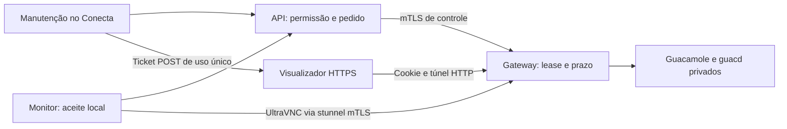

# Acesso remoto assistido — piloto da loja 49

**Candidato 0.7.0 com geração local autorizada; acesso remoto desativado por padrão. O ZIP é preparado no macOS, sem execução em Windows ou instalação nas lojas. Conecta/API não foram publicados.** Conferir UUID e computador da instalação já usada no teste da loja 49. Nome do Windows não identifica o caixa; exemplos têm IDs/domínios/hashes fictícios.

## Implementação

- Conecta/API: pedido com motivo, autorização por técnico/computador, consentimento local, auditoria transacional, expiração e encerramento próprio/administrativo.
- Monitor: polling HTTPS autenticado, XML fechado, diálogo local, lease, heartbeat, suspensão e recuperação de pendências sem reutilizar aprovação.
- Windows: perfil administrativo; console desbloqueada; binários assinados/hashes aprovados; stunnel e UltraVNC temporários sob Job Object/watchdog; fiscalização de listeners IPv4/IPv6.
- Gateway: mTLS por máquina, vínculo certificado/agente/ID ModeII, prazo próprio, porta privada exclusiva e revogação.
- Visualizador: ticket POST de uso único até 30 s, cookie HttpOnly, cliente Guacamole, teclado/mouse, duração e Encerrar. Senha VNC, chave JSON e authToken ficam no servidor.

Os adaptadores estão integrados. O código admite Windows 7 SP1 e Windows 10/11 em estações x86/x64, com processo nativo, CLR 4 e .NET Framework 4.6.2 ou posterior; recomenda-se WMF 5.1 e .NET 4.8. Falta homologação de cada perfil com programas reais. O perfil x86 ainda depende de uma build atual de stunnel construída, assinada e homologada; não existe bundle x86 operacional preparado. Consulte [compatibilidade Windows 7](windows/COMPATIBILIDADE-WINDOWS7.md). O núcleo usa a versão 0.7.0 e a lista fechada de 22 arquivos. A primeira migração de 0.6 ou anterior é manual; o feed antigo não aceita o novo conjunto. Não houve alteração de banco nem inicialização da infraestrutura. Consulte [GUIA-INSTALACAO-0.7.md](../GUIA-INSTALACAO-0.7.md).

O núcleo continua por usuário em `%LOCALAPPDATA%\Feirao\PdvMonitor\programa`. O adaptador Windows é importado apenas de `%PROGRAMDATA%\Feirao\PdvMonitorRemoto\app\PdvMonitor.Remoto.Windows.psm1`, com conferência prévia de proprietário/ACLs, ancestrais, reparse points e hard links; não há fallback para cópia no perfil do usuário. Para a primeira preparação administrativa, fechar o monitor e executar `windows\PrepararRemoto.cmd` explicitamente como administrador. Ele copia apenas código e modelos inativos; o perfil ativo, quando aprovado e provisionado separadamente, será `app\piloto-remoto\windows\remoto-piloto.xml`. PKI e programas de terceiros não são distribuídos. Instalação administrativa existente exige revisão e não é sobrescrita. O atualizador do usuário não altera essa extensão.

O gateway é código próprio compatível com o enquadramento **UltraVNC ModeII**, não o executável oficial Repeater: bloco de 250 bytes `ID:<número>` preenchido com NUL, depois RFB opaco. O guacd recebe porta VNC privada por atendimento. Compatibilidade completa com o UltraVNC depende do ensaio Windows.

A saída da loja usa TLS 1.2+ mútuo. O trecho guacd↔gateway fica em rede Docker isolada, sem camada criptográfica adicional; não anunciar criptografia ponta a ponta. Não expor 5900, 4822 ou portas privadas de visualizador. ID e senha VNC sozinhos não são autenticação suficiente entre lojas.

## Consentimento e encerramento

Cada pedido mostra técnico, motivo, capacidade de ver/controlar e prazo; recusa é padrão. Aprovação exige confirmar ausência de venda/pagamento. Pausa, troca/bloqueio da console, saída do monitor, perda de autorização/rede e expiração encerram os processos próprios. Não há retomada após crash.

Lease máxima de 15 min; o supervisor local usa relógio monotônico, nunca amplia prazo por latência e encerra sem consulta nova autenticada em até 15 s. O gateway tem timer independente. Recuperação do Nerus/atualização ficam bloqueadas durante pedido/atendimento/fechamento; inventário e dispositivos continuam sendo coletados.

`pending`/`ready`/`connected` descrevem transporte, sem provar impressão ou atendimento resolvido. A janela anuncia conexão após negociação do cliente Guacamole. Falha ao encerrar não é anunciada como encerramento confirmado.

## Identidades, segredos e navegador

Controle API→gateway exige CA autoassinada dedicada a clientes de controle e pin do certificado exato da API. Dispositivos usam outra CA autoassinada, distinta, com SHA256 vinculado ao UUID e ID Mode II. A lease exige também o pin esperado no cadastro central. Certificados de servidor têm emissores/SAN próprios e validação normal.

Chaves de CA não vão aos caixas/containers. Cada caixa recebe apenas sua chave/certificado e CA pública do servidor. Código, perfil, PKI e programas ficam em diretório administrativo protegido contra escrita pelo operador. Dados/journals temporários ficam separados. Senha VNC aleatória exclusiva, com oito caracteres ASCII imprimíveis, limite do mecanismo clássico.

O ticket é entregue por POST, nunca query/fragmento. O cookie `Secure; HttpOnly; SameSite=Strict` tem caminho exclusivo da sessão. Documento intermediário no domínio do visualizador evita redirecionamento cross-site que pode omitir Strict. URL contém apenas ID público. Túnel HTTP usa CSRF e token próprio; authToken e token HTTP interno do Guacamole não chegam ao browser. Não usa localStorage/sessionStorage, gravação de tela, áudio, clipboard, arquivos ou logs de teclado.

Depois de desconectar, uma memória de até 60 s permite somente confirmar `closed` com o mesmo cookie/CSRF, caso disconnect chegue antes de END. Não reabre transporte; cookie é apagado na confirmação.

## Infraestrutura desativada

Compose exige perfil `pilot`, configuração e imagens oficiais revisadas/fixadas por digest. Não inclui Conecta/API/banco nem aplica SQL. Portas de ingresso são loopback 5443 para dispositivo TLS e 8443 para visualizador HTTPS. Guacamole e guacd não têm porta publicada. Conferir sub-redes, rede privada da API e ingresso TCP/TLS passthrough dedicado; proxy HTTP/ALB que termine mTLS não preserva a identidade do caixa. Para saída por 443, usar ingresso TCP dedicado.

A chave JSON de 128 bits fica apenas no gateway e Guacamole. Arquivo da chave, senhas e chaves TLS exigem permissões privadas; journal pertence ao usuário efetivo do processo (UID 1000 na imagem Node oficial). Não usar variáveis `NEXT_PUBLIC_` para segredos. O trecho nginx-viewer.conf.example exige HTTPS com validação do upstream e não substitui o nginx atual.

Bundle `guacamole-common-js/all.min.js` vem da imagem interna, com SHA256 obrigatório previamente aprovado; atualizar imagem exige revisar o hash. O teste de navegador usou bundle oficial 1.6.0 de WAR Apache cujo SHA256 oficial foi conferido. O pacote temporário não foi instalado/incluído nas fontes nem no monitor. Não incluímos binários UltraVNC/stunnel.

Desabilitar logs de URL/body/cookies/headers nas rotas de autenticação/túnel, inclusive Guacamole/Tomcat. Não ativar debug ou gravação de sessão. O código não registra conteúdo, mas proxies/observabilidade precisam da configuração correspondente.

## Estado durável

Journal schema 2 contém IDs, datas, hash do pedido, estados e `usedPorts`, sem segredos. Porta é reservada no disco antes do uso e **nunca reutilizada automaticamente**, nem após expiração/reinício. Ao esgotar 256 portas do exemplo, recusar novos pedidos.

Startup exige journal existente e lock exclusivo. Crash não retoma acesso; lock órfão exige revisão administrativa. Falha de persistência derruba fluxos. Não apagar/retroceder journal para liberar portas. Inicialização/reciclagem exige Guacamole e guacd parados, JSONkey nova e invalidação de contextos antigos. init-state.js é offline e nunca chamado pelo startup/atualizador. Não restaurar backups do estado e contextos independentemente.

## Antes da liberação

1. Confirmar UUID, SO e arquitetura da instalação da loja 49. O código aceita estações Windows 7 SP1 (`6.1.7601`) ou Windows 10/11 (`10.0`, build >= `10240`), x86/x64, processo nativo e CLR 4 com .NET >= 4.6.2. Windows 7 sem SP1, Vista, 8/8.1, Server, ARM e arquitetura divergente permanecem bloqueados.
2. Usar configuração administrativa schema `2` com `PlatformProfile` exato: `win7-sp1-x86`, `win7-sp1-x64`, `win10plus-x86` ou `win10plus-x64`. Homologar por perfil versões, assinaturas, hashes, dependências, portable, senha reversa e ausência de listeners externos. x86 exige antes construir e assinar um stunnel atual; uma aprovação x64 não vale para x86. No Windows 7, Host em Job herdado bloqueia a tentativa antes de executar filhos, sem breakaway. Conferir licenças/avisos antes de distribuir.
3. Preparar PKI/perfil administrativo, servidor/rede, DDL no banco explicitamente escolhido, permissão `remote_control` e grant curto para técnico/instalação. Nada é habilitado pela migração.
4. Fora do atendimento, testar tela/entrada, recusa, timeout, pausa, console/UAC/troca de usuário, rede, crash, revogação e prazo. Conferir impressão/TEF preservados.
5. Homologar Defender e Panda quando presente com proteção ativa. Assinatura ajuda a identificar origem, sem garantir ausência de falso positivo. Não desabilitar proteção nem criar exclusão geral.
6. Usar o candidato 0.7.0 na instalação manual assistida; a geração do ZIP já está autorizada. Publicação do Conecta/API/feed, preparação do servidor e instalação nas lojas dependem da etapa de implantação correspondente. Não enviar o pacote de 22 arquivos ao atualizador 0.6 nem copiar arquivos sobre monitor aberto. A extensão administrativa exige revisão própria e não é atualizada pelo núcleo.

## Validações locais

Resultados da etapa anterior, anteriores à adaptação dos perfis Windows 7/x86: gateway/cliente: 30 testes, incluindo cliente real de controle da API, mTLS, tickets, CSRF, concorrência, revogação e lifecycle do browser. API: regressão local de 100 testes equivalentes e lint; após ajuste final do preparo, 19 testes unitários remotos aprovados. Frontend: regressão de 54 testes e lint; após o mesmo ajuste, 17 testes remotos aprovados. Monitor: 26 suítes+parser; Windows: 25 casos/117 verificações e transporte/Host/driver: 95 verificações novas. C# compilou sem executar PInvoke.

Chrome isolado: bundle oficial, Guacamole/protocolo sintéticos, abertura cross-site POST/Strict, canvas renderizado, foco/tecla, ausência de segredo em URL/storage e encerramento confirmado. Não comprova Windows/UltraVNC/guacd reais. Compose validado estaticamente; containers não iniciados. Nenhuma instalação, publicação, alteração de banco ou acesso ao caixa.

Gateway: `npm test` em gateway/. O caso do cliente real da API usa `PDV_REMOTE_BACKEND_SOURCE` apontando para o snapshot local, sem iniciar app/banco. PowerShell usa mocks e pastas temporárias. Windows/WinForms/DPAPI/PInvoke, binários e antivírus dependem de homologação.

[UltraVNC Repeater](https://uvnc.com/docs/ultravnc-repeater.html) · [Guacamole JSON](https://guacamole.apache.org/doc/gug/json-auth.html) · [HTTP tunnel 1.6.0](https://github.com/apache/guacamole-client/blob/1.6.0/guacamole-common/src/main/java/org/apache/guacamole/servlet/GuacamoleHTTPTunnelServlet.java) · [stunnel mTLS](https://www.stunnel.org/auth.html).

Ver GUIA-REMOTO-INTEGRACAO.md no diretório pai, windows/README.md e contrato-gateway.json.
